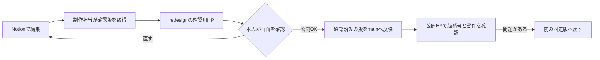

# Notionを編集し、確認してから公開する

Notionの写真・文章・表示設定を「確認版」に固定して配信します。**2026-10-28 JST、PR #13で本番へ移行済みです。Notion保存だけでは確認用・本番とも更新されません。制作担当が確認版を取得し、確認した同じ版を公開します。** 京都予約入口もPR #15で公開済みです。現在の版は下の`cms:status`で照合し、初回導入時の版番号を現在値と混同しません。



## 日常の操作

1. 編集担当はNotionの「写真とことば」「店舗とお知らせ」などで変更します。「表示する」は**次の確認版に含める指定**です。画像・本文・日英・店舗・メニュー公開設定を一組として確認します。
2. 制作担当が取得し、確認用HPを更新します。Notionを保存しただけでは、固定版導入済みのHPは変わりません。
3. 本人は確認用HPのPC/スマホ表示を見ます。直した場合は再取得・再確認します。確認後のNotion追記は、既に固定した版に混ざりません。
4. 本人の公開判断後、制作担当が**同じ版**を本番へ反映します。サイト全体が一つの公開単位です。
5. 公開HPの版番号が確認版と一致し、写真・リンク・日英・受付案内が正常なら完了です。

現時点ではNotion内に「公開する」ボタンはありません。取得・プレビュー配備・公開・差し戻しは、GitHub/Vercelの権限を持つ制作担当が行います。編集するためにアカウントや課金を追加する必要はありません。

編集担当・公開判断は当面サイト管理者。制作担当への依頼には「編集したNotionの行」「変えたい画面」「公開希望時刻」を添えます。制作担当はプレビューURL・内容版・確認項目を返し、その版への公開OKを記録します。担当交代時はGitHub/Vercelの操作権限を先に確認します。

## 制作担当の取得・検査

Node 24以上、既存のNotion読取接続を利用します。秘密値は出力・コミットしません。

```sh
npm run cms:capture
npm run cms:verify
npm run build
```

- `src/content/cms-release.json`に表示用の値と版番号を保存し、写真も`src/content/cms-assets/`へ固定します。予約台帳・メール・連絡先・秘密の設定は含めません。
- DB設定不足、取得失敗、画像取得失敗、取得中の編集を検出した場合は、新しい版を確定しません。直前の版を維持します。
- 非公開メニューは本文も写真も取得しません。タイトルが空のお知らせ・商品は表示しません。日英の表示は独立し、空の英語版を日本語で補いません。
- `git diff`で編集意図と照合し、`redesign`だけへコミット/pushします。本番への反映は別の公開判断です。
- `cms-assets`の過去ファイルを削除する場合は、公開中・確認中・復旧対象の版に必要なファイルを残してください。配信APIはその配備版の登録画像しか返しません。

## 配備後の照合

```sh
npm run cms:status -- https://chasen-site-git-redesign-ashan06re-2847s-projects.vercel.app
npm run cms:status -- https://chasenco.com
```

`matches: true`が、手元の固定版とそのURLの内容版が同一である証拠です。公開前は本番との差が正常です。公開後は両方を一致させます。認証保護の画面が返る場合は、ログイン済みのブラウザで`/api/cms-release`を開いて確認します。

## 戻す・止める

- 固定版導入後の前のGitコミット/配備へ戻せば、そのときの写真・本文・表示設定へ戻ります。戻した後も版番号と日英の主要導線を確認します。
- 固定版導入前へ戻すとNotion直接読取へ戻るため、通常の差し戻し先には使いません。最初の導入版を復旧基準にします。
- 写真の削除・非表示は次の版の公開で反映します。既に閲覧者が保存した写真や外部キャッシュの回収はできません。
- 予約の緊急停止は予約システム側でフォームを閉じます。HPの公開版更新を待ちません。リンクが残っていても申込みを受け付けない状態を確認し、その後HPの案内を更新します。
- リリース記録には、確認用commit・内容版番号・確認者・公開判断・本番配備・差し戻し先を残します。
